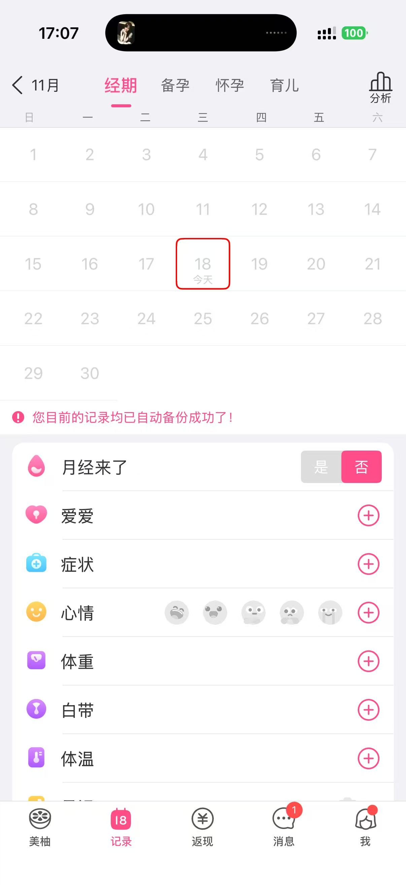
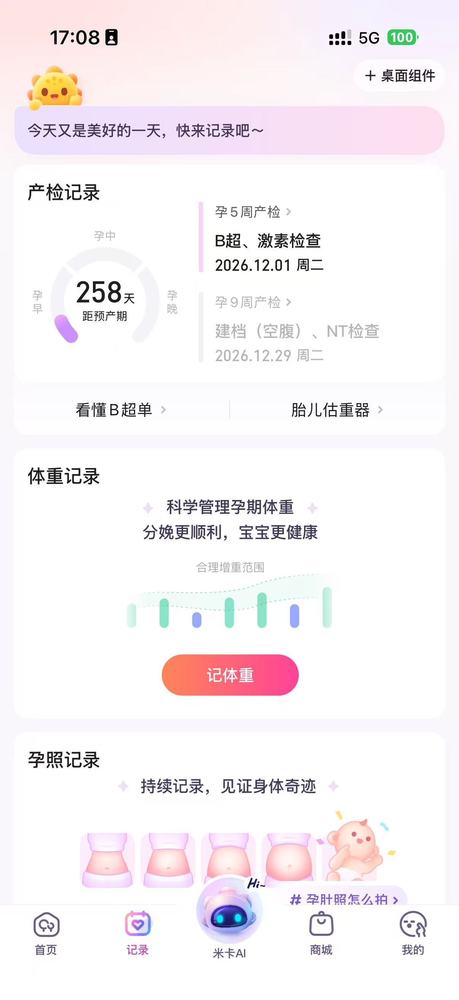
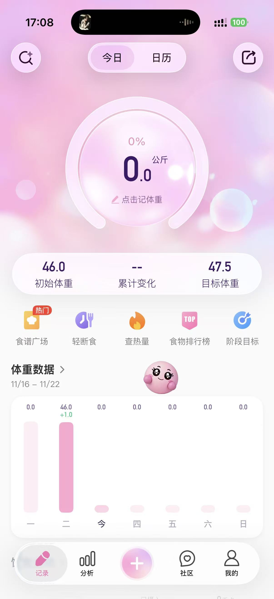
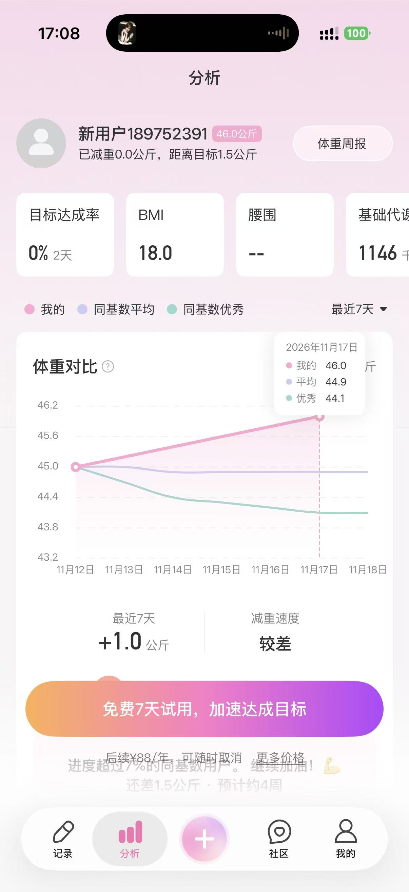

# 女性健康记录助手 UI/UX 设计文档

版本 V1.0｜移动端优先｜业务依据：[女性健康记录助手需求文档 V0.8](女性健康记录助手需求文档.md)

## 1. 参考图怎么用

视觉方向：**浅粉与淡紫的页首、白底内容区、深色正文、清晰的数字与日期**。保留截图中的轻柔感和清楚的操作层级，整体更接近一本私人健康日记。

| 参考图 | 借鉴 | 在本产品中的应用 |
|---|---|---|
| 图 1：经期月历 | 月份切换、七列日历、选中日描边，日期下方紧接当天记录 | 经期页采用同样的信息顺序；只保留经期和感受操作，不沿用备孕、怀孕、育儿入口。 |
| 图 2：粉紫记录页 | 顶部轻渐变、白色内容面、明确的「记体重」按钮 | 首页快捷入口和各页主要按钮沿用这种层级；不加入产检、孕照、商城或桌面组件。 |
| 图 3：体重记录 | 大号体重、单位降级显示、录入入口贴近数据 | 体重页顶部突出最近一次测量，与「记体重」放在同一区域；无数据用「暂无记录」，不用 0.0 占位。首版不做目标进度环。 |
| 图 4：体重分析 | 时间筛选、趋势图和点击数据点的浮层 | 只绘制本人曲线，浮层显示真实日期、时间、kg；不使用同群比较、「较差」评级或订阅遮罩。 |

截图用于评审参考，不作为背景、图标或品牌素材。图中的状态栏由设备系统负责，应用不仿制。

**图 1：经期月历**

**图 2：粉紫记录页**

**图 3：体重记录**

**图 4：体重分析**

## 2. 视觉规格

| 项目 | 推荐值与用法 |
|---|---|
| 背景与内容面 | 页面 `#FAF7FA`，内容面 `#FFFFFF`。页首可用 `#FDE8EF → #EFE8FA` 的淡渐变，向页面背景过渡；表单、聊天阅读区和图表保持素净。 |
| 操作色 | 主要按钮 `#A82760` 配白字；选中底 `#F7DFEA` 配深莓色文字。亮粉用于少量装饰，不作为浅底小字号正文。 |
| 文字与边界 | 正文 `#2D2430`，次要文字 `#655966`，装饰分隔线 `#E9E0EA`；表单轮廓 `#8B7988`。错误用 `#A32638` 加文字说明。 |
| 字号 | 页标题 24/32，区标题 18/26，正文和输入 16/24，辅助文字 13/20，体重数字 36/44，单位 16/24。使用系统中文字体，数值使用等宽数字特性。 |
| 间距与圆角 | 页边距 16，区块间距 24，内容间距 8 或 12；内容面圆角 8，按钮高 48，分段选择器可用胶囊形。避免卡片套卡片。 |
| 导航与图标 | 底部五栏：首页、经期、体重、皮肤、我的。用同一套线性图标和文字；选中项加底色与字重。图标按钮仍需可访问名称，常用点击区域至少 44×44。 |

以 390 CSS px 宽作为设计基准，检查 320 与 430 宽。日历始终七列，长文可换行；桌面居中展示，主内容建议最大宽 560 px。底栏和聊天输入区避开安全区，页面滚动时不能遮住最后一条内容。文本和交互状态检查对比度，实际/预计、选中/未选中均使用形状或文字辅助区分。

## 3. 逐页布局与交互

### 首页

首屏顺序：**标题 → 三个快捷入口 → 聊天消息 → 底部输入框 → 五栏导航**。三个入口用等宽图标加文字：「记经期」「记体重」「拍照分析」。点击打开与业务页共用的表单或拍照流程；完成或取消后返回来处，保存的内容在对应业务页可见。

聊天空态可放可点击示例：「最近体重有什么变化？」「上次经期什么时候开始？」回复为舒适可读的正文，涉及已有记录时标出日期或统计范围。发送后保留用户问题并显示「正在回答」；失败在消息旁提供「重试」；缺少资料时直接说明。**聊天只读，不生成填写草稿，也不发送皮肤原图。** 键盘弹出后输入框留在可视区域，消息区可继续滚动。

### 经期页

首屏顺序：**状态摘要 → 月份切换 → 月历和图例 → 选中日记录 → 历史回顾**。默认本月、选今天；月份切换箭头有明确标签。点某日后只更新选中样式和下方内容，原地提供「记录经期」「记录感受」。实际经期和感受独立显示与编辑。

| 日历状态 | 表现 |
|---|---|
| 实际经期 | 浅粉实底加深色日期；同一段可连续着色。 |
| 预计开始 | 预计当天用莓色虚线描边，图例写「预计开始」，不铺满多天。 |
| 今天与选中日 | 今天加「今天」文字；选中日用独立实线焦点框，与经期标记可以共存。 |
| 有感受记录 | 日期下方加小点；选中该日后显示具体内容。 |

确认的当前经期状态优先，预计日期可作次要信息；记录不足、波动较大或预计日期已过时显示 V0.8 对应提示。预计日不会被视作实际记录，不用作避孕依据。历史列表区分「持续 N 天」与「距上次开始 N 天」，缺结束日显示「未记录结束」。

### 体重页

首屏顺序：**最近体重与时间＋记体重 → 趋势图＋记录明细 → 一条建议**。顶部数字用大字显示，例如 `58.2 kg`，下方显示测量日期时间。记体重打开数字录入表单，显示固定 kg 单位，可改测量时间、选填标签和备注。

趋势默认近 30 天，使用「近 7 天｜近 30 天」分段选择。图表采用细网格、莓色折线与数据点，点击点展示当次测量，单位固定 kg。缺测日期不补 0 或虚构点；同日只绘最后一次，注明口径。没有记录时引导添加，只有一个记录日时展示单点，不展示首尾变化。统计与建议分开，体重升降不使用好坏评级。「记录明细」进入二级页，保留全部测量，支持筛选、编辑与删除。

### 皮肤页

沿用同一视觉体系，交互按 V0.8 自行设计，参考图不作为皮肤功能依据。主页面先显示「拍照分析」和「历史记录」入口，再展示最近一次已保存观察。流程为 **选择部位 → 拍照与预览 → 确认发送 → AI 观察 → 保存／不保存／重拍**。发送前明确照片会提交给模型服务分析。

结果页按「照片中可见」「看不清的地方」「下次可留意」分段，标记「AI 观察」。照片模糊建议重拍，分析失败保留预览并提供重试；不显示诊断、严重度或改善百分比。「保存」为主按钮，其他两项明确可见。只有保存成功后更新历史。可选的两次对比从同部位历史由用户手选，显示两张等宽图和各自日期；如有模型摘要，标注「基于两次文字观察」。

### 我的、登录与注册

「我的」使用单列白底表单：用户名只读，生日、身高（cm）、电话选填；下方为「保存资料」和分开的「退出登录」。退出后回登录页，保留记录。电话只用于个人资料。

登录和注册使用浅色页首及单列表单，不显示底部导航。字段使用常驻标签，密码可切换显隐，失败信息靠近对应操作；注册成功返回登录，登录成功进入首页。

## 4. 通用反馈与设计验收

- **表单**：显示必填和校验信息；提交中禁用重复操作；失败保留已填内容，成功后更新实际记录。取消不写入。有未保存修改时关闭表单，可确认是否放弃。
- **导航**：一级页使用固定五栏；历史和分析结果等二级页提供返回入口，返回来处，避免把快捷录入做成另一份数据。
- **演示验收**：用模拟账号从首页补记经期、量体重和拍照，验证各模块可回看；聊天提问后记录数不变。用模拟周期检查预计与实际标记；体重缺测不显示 0；皮肤选择不保存或重拍不会新增历史。
- **视觉验收**：用 320、390、430 px 检查日历七列、底栏标签、单位、图表提示和长回复无重叠；打开软键盘检查输入框；检查空态、加载、失败和保存成功状态均可辨认。

交付优先级：先完成共享颜色、字体、按钮、导航和表单，再完成首页、经期月历、体重趋势与皮肤单次分析。皮肤历史对比仍为可选；重度插画、玻璃动效和装饰性指标不作为比赛验收项。
